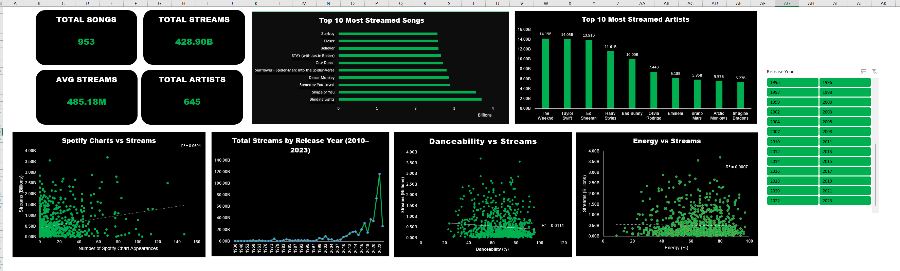

# Spotify Streaming Data Analysis

## Project Overview
This project explores Spotify streaming data to identify popular songs, top artists, and music trends. The goal is to analyze streaming patterns and understand the relationships between different music features and streaming numbers.

## Tools Used
- Microsoft Excel 2016
- Power Query
- Pivot Tables
- Pivot Charts
- Slicers
- Data Cleaning
- Data Analysis

## Data Cleaning
- Cleaned and transformed the dataset using Power Query.
- Removed unnecessary columns.
- Handled data format errors.
- Prepared the dataset for analysis.

## Analysis
The project includes:
- Top 10 Artists by Streams
- Top 10 Songs by Streams
- Danceability vs. Streams
- Acousticness vs. Streams
- BPM vs. Streams
- Valence vs. Streams
- Music Trends by Year
- Energy Analysis
- Playlist Analysis
- Charts Analysis

## Key Insights
- Blinding Lights is among the most streamed songs, with approximately 3.7 billion streams.
- The Weeknd has approximately 14.19 billion total streams in the analyzed dataset.
- Danceability, acousticness, and valence show very weak relationships with streaming numbers.
- Playlist inclusion analysis shows a stronger relationship with streams (R² = 0.6238).

## Dashboard
An interactive Excel dashboard was created to present the key findings through charts, tables, and a year slicer.

## Conclusion
This project helped me practice data cleaning, data transformation, data analysis, and dashboard creation using Microsoft Excel.
